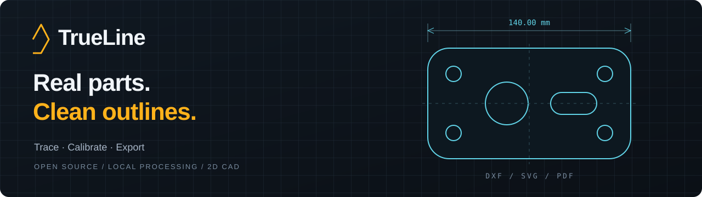
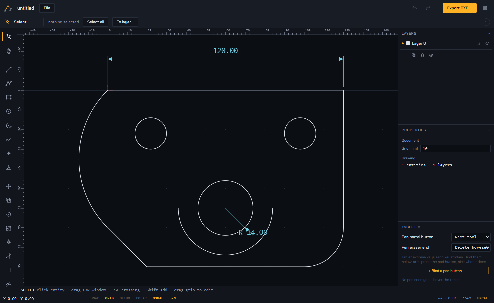
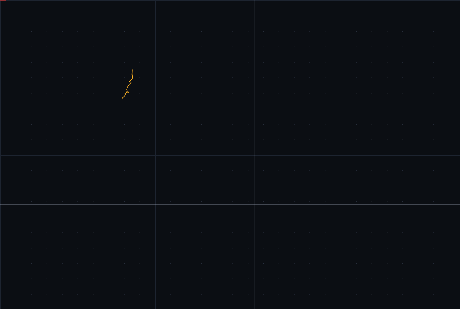

<p align="center">
  
</p>

<h1 align="center">From the workbench to CAD.</h1>

<p align="center">
  Turn physical parts, sketches, and photos into editable 2D outlines.<br>
  Auto-trace a photo or draw with a mouse or pen tablet.<br>
  Set the real size. Export for your next build.
</p>

<p align="center">
  <a href="https://github.com/Nik-Horner/TrueLine/releases/latest/download/TrueLine-Setup.exe"></a>
  <a href="https://github.com/Nik-Horner/TrueLine/actions/runs/37727690760/artifacts/11528825944"></a>
  <a href="LICENSE"></a>
</p>

<p align="center">
  <a href="#from-photo-to-cad">Quick start</a> ·
  <a href="docs/guide.md">User guide</a> ·
  <a href="#run-from-source">Build from source</a> ·
  <a href="CHANGELOG.md">Changelog</a>
</p>

<p align="center"><strong>Free to use. Local photo processing. No account required.</strong></p>



<p align="center"><sub>Editable geometry, real measurements, and DXF / SVG / PDF export.</sub></p>

## Photo tracing, built in

**Turn a part photo into an outline you can edit.** TrueLine uses the bundled MobileSAM
model locally to help detect the part. Crop the photo, review its outer edge and openings,
and correct points or draw missing cutouts before choosing **Add outline**.

- **Keep photos on your device.** No cloud upload, model download, or inference server needed.
- **Stay in control.** Zoom into the preview, edit contours, and undo corrections before adding geometry.
- **Take it into CAD.** Calibrate from a known measurement, then export DXF, SVG, or PDF.

Use a flat part on a contrasting background. Shadows, glare, touching objects, and hidden
edges can affect the result; review the outline and verify dimensions before fabrication.

## Get TrueLine

**Windows:** [Download the installer](https://github.com/Nik-Horner/TrueLine/releases/latest/download/TrueLine-Setup.exe).

**macOS 12+:** [Download the 3.1.1 preview](https://github.com/Nik-Horner/TrueLine/actions/runs/37727690760/artifacts/11528825944)
for Apple Silicon and Intel. GitHub sign-in is required.

<details>
<summary><strong>Installing the macOS preview</strong></summary>

Unzip the download, open the `arm64` DMG for Apple Silicon (M-series) or `x64` DMG
for Intel, then drag TrueLine into Applications. Replace any older copy.
The preview uses local signatures and is not Apple-notarized; macOS may require
**System Settings → Privacy & Security → Open Anyway**.

</details>

[Development builds](https://github.com/Nik-Horner/TrueLine/actions/workflows/desktop-build.yml)
are also available.

## From photo to CAD

1. **Choose a photo.** Photograph one flat part against a contrasting background. Choose
   **File → Upload image**, then **File → Auto-trace image outline**. Crop around the part if needed.
2. **Review and correct.** Use **Edit outline** to adjust points or openings, then choose **Add outline**.
3. **Set the real size.** Click **Set scale**, click the ends of a known feature, and enter
   its measured length.
4. **Check and export.** Use **Check contours** to review gaps, duplicates, and intersections,
   then export DXF, SVG, or PDF. Save a project file to keep editing later.

Prefer to trace by hand? Enter **Tracing mode** for a larger drawing area and review the
fitted lines and curves before accepting each stroke. For parts that need repositioning,
trace separate assembly pieces and align them with shared reference marks.

## Built for tracing real things

- **Editable photo outlines:** local AI-assisted tracing, crop, point correction, and opening edits.
- **Drawing and cleanup:** lines, circles, arcs, fitted freehand curves, trim, offset, fillet, and chamfer.
- **Trace review and assembly:** compare strokes with fitted geometry and align separate pieces
  using translation and rotation, with a reference-error preview.
- **Contour checks:** locate gaps, duplicate edges, and intersections; join compatible paths
  with explicit gap connectors.
- **Accurate setup:** snapping, layers, dimensions, photo perspective correction, and calibration.
- **Tablet and Mac controls:** customizable shortcuts, pen buttons, Retina rendering, and trackpad navigation.
- **Save and export:** DXF import/export, SVG, PDF, native projects, autosave, and recovery history.

<details>
<summary><strong>See tracing in action</strong></summary>



</details>

## Your files, your workflow

- **Editable projects:** save `.trueline.json` files with geometry, images, and assembly state.
- **CAD exchange:** import and export DXF; export SVG for vector workflows or PDF for printing.
- **Local recovery:** autosave keeps recent revisions on this device. Save a project file
  separately to preserve work outside local recovery storage.

For a full-size paper template, print the PDF at **100% / actual size** and verify a known
dimension on the print before using it.

## Documentation

- [User guide](docs/guide.md) — tracing, photo setup, assembly, and outline correction.
- [Development](docs/development.md) — builds, tests, model evaluation, and releases.
- [Changelog](CHANGELOG.md)

## Run from source

Requires Node.js 22.12+; Node 24 is recommended.

```bash
git clone https://github.com/Nik-Horner/TrueLine.git
cd TrueLine
npm ci
npm start
```

The desktop shell uses Electron; the drawing app uses plain JavaScript ES modules.
No frontend compilation step is required.

### Test and package

```bash
npm test             # geometry, exports, tracing, workflows, and desktop wiring
npm run verify:models # check bundled model files against their recorded hashes
npm run pack         # create a portable desktop app in dist/
```

See the [development guide](docs/development.md) for platform-specific installers,
Chromium UI checks, and photo/model evaluations. Those suites have additional prerequisites.

## Contributing

For a bug report, include your operating system, TrueLine version, steps to reproduce, and
the expected result. A sample project or image helps when you can share it.
[Open an issue](https://github.com/Nik-Horner/TrueLine/issues) or submit a focused pull request.
Run the relevant checks from the development guide when changing application behavior.

## License

[MIT](LICENSE). Bundled fonts use the [SIL Open Font License](fonts/OFL.txt).
[MobileSAM](models/mobile-sam/NOTICE) uses Apache 2.0;
[ONNX Runtime](js/vendor/onnx/LICENSE) uses MIT.
